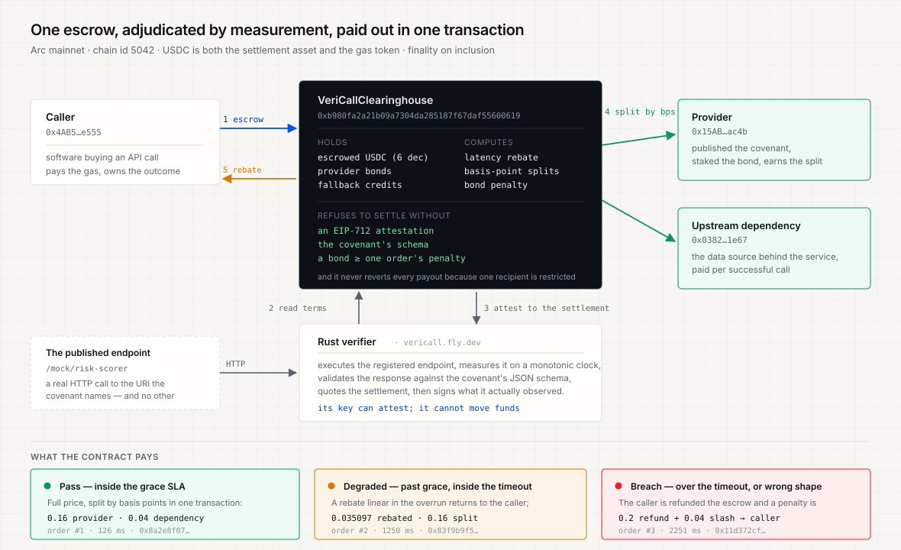
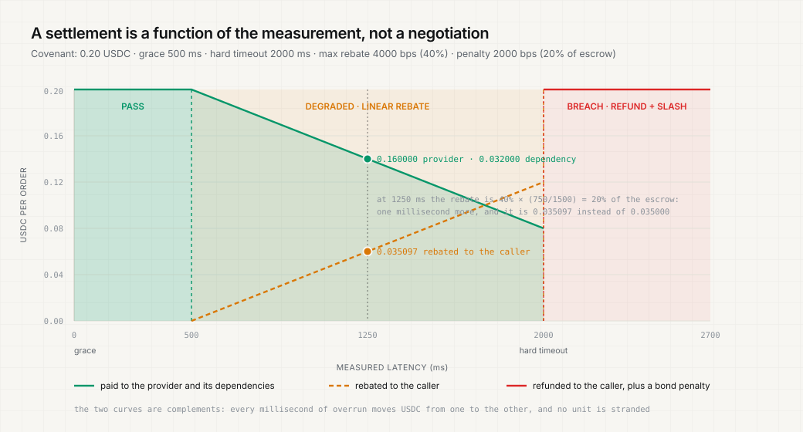

# VeriCall

**Escrow a USDC payment for a software-to-software API call. Settle it against the promise the API published — latency and response schema — and split the money across the provider and its upstream dependencies in the same transaction.**

Live on Arc mainnet · [**vericall.fly.dev**](https://vericall.fly.dev) · contract [`0xb980fa2a21b09a7304da285187f67daf55600619`](https://explorer.arc.io/address/0xb980fa2a21b09a7304da285187f67daf55600619)

---

## The problem in one paragraph

Software pays software now. Agents buy inference, enrichment, parsing and audits from other endpoints, usually in USDC, usually prepaid — `x402` settles on the request, prepaid API credits settle on the invoice. Both are *pay-and-pray*: if the endpoint answers 1.4 seconds later than the pipeline can wait, or returns JSON that does not match the shape the caller's code needs, the caller has already paid and has no recourse. The failures are not adversarial, they are ordinary — an upstream feed is slow, a model returns a string where a number was promised. Meanwhile the provider of a composable service has no way to pay the data source or model it depends on per successful call, so upstream work goes uncompensated or is invoiced monthly at a loss. **VeriCall makes the payment conditional on the delivery, and distributes it in the same transaction.**

## What it does

A provider publishes a **covenant** on Arc: a price in USDC, a grace latency, a hard timeout, a maximum rebate, a breach penalty, a JSON schema the response must satisfy, and a table of who gets paid what by basis points.

A caller escrows the price. A verifier executes the call for real, measures it, validates the response against the covenant's schema, and signs an EIP-712 attestation of what happened. The contract then decides, from that measurement alone:

| Verdict | Condition | Money movement |
| --- | --- | --- |
| **Pass** | latency ≤ grace, schema satisfied | Full price splits across the covenant's recipients — provider and its upstream dependencies — in one transaction |
| **Degraded** | latency between grace and hard timeout, schema satisfied | A rebate accrues **linearly in the overrun**, up to the covenant's maximum, and returns to the caller; the remainder splits |
| **Breach** | latency over the hard timeout, or a response outside the schema | The caller is refunded the full escrow **and** a penalty is slashed from the provider's staked bond |
| **Expired** | nobody settled before the window closed | Anyone may send the escrow back to the caller |

The rebate is not a policy decision made by a human after the fact. It is arithmetic in the contract, and `quoteSettlement` will tell you the exact outcome for a latency *before* you agree to it.

## Proof: real USDC on Arc mainnet

Every row below is a real Arc mainnet transaction against the deployed contract. The caller, the provider and the upstream dependency are three distinct wallets; the money really moved. Two covenants are exercised, with different prices, different rates and different splits — **80/20** and **70/30**.

### Counterparty Risk Scorer — 0.20 USDC, grace 500 ms, hard timeout 2000 ms, max rebate 40%, penalty 20%

| # | Verdict | Measured | What the chain did | Transaction |
| --- | --- | --- | --- | --- |
| 1 | **Pass** | 126 ms, schema valid | **0.16 USDC** → provider, **0.04 USDC** → upstream dependency | [`0x8a2e8f07…`](https://explorer.arc.io/tx/0x8a2e8f07a0c1e0bf28dae3c4b0a23c853ffc4f7d4f591f02f689e10af0833cc1) |
| 2 | **Degraded** | 1250 ms, schema valid | **0.035097 USDC** rebated to the caller, **0.128** → provider, **0.032** → dependency | [`0x83f9b9f5…`](https://explorer.arc.io/tx/0x83f9b9f51c03316415b99533a4967940471d13cdc98db177406712eba647028f) |
| 3 | **Breach** | 2251 ms, schema violated | **0.236713 USDC** to the caller: the full 0.2 escrow refunded plus a 0.04 penalty slashed from the provider's bond | [`0x11d372cf…`](https://explorer.arc.io/tx/0x11d372cfc5db58a1d3af74f9f960ba80a43b7e9462434329c49708ae9cf7bb31) |
| 4 | **Pass, attested by the live public verifier** | 129 ms, schema valid | **0.16 USDC** → provider, **0.04 USDC** → dependency | [`0xf648f251…`](https://explorer.arc.io/tx/0xf648f251650a7315d8c6f6a87126ceebbc0e3dbd03d0171eb548be816778ef7f) |

### Invoice Field Extractor — 0.15 USDC, grace 400 ms, hard timeout 1500 ms, max rebate 50%, penalty 25%

| # | Verdict | Measured | What the chain did | Transaction |
| --- | --- | --- | --- | --- |
| 5 | **Pass** | 104 ms, schema valid | **0.105 USDC** → provider, **0.045 USDC** → dependency | [`0x2605bebd…`](https://explorer.arc.io/tx/0x2605bebdb1598ec64150c052f92024de86a947f16a71bb248e75b5b55bd44b0e) |
| 6 | **Degraded** | 953 ms, schema valid | **0.037704 USDC** rebated to the caller, **0.078608** → provider, **0.033688** → dependency | [`0xd330264a…`](https://explorer.arc.io/tx/0xd330264a95619e88bf8a7f4dd4c653e2edb569797b78f03d2b595940c7ca6d4c) |
| 7 | **Breach** | 1753 ms, schema violated | **0.1875 USDC** to the caller: 0.15 refunded plus a 0.0375 bond penalty | [`0x4533793e…`](https://explorer.arc.io/tx/0x4533793edb45704ceaba12584d45da13a8c975324e1f19a9f7bd47ae9b872126) |

Order 2 is worth reading closely: the call ran for **1250 ms**, one millisecond past the half-way point between the 500 ms grace and the 2000 ms hard timeout, so the rebate is **0.035097 USDC** — not "about 3.5 cents", but the exact consequence of that one millisecond. The same arithmetic runs for order 6: 953 ms against a 400 ms grace and a 1500 ms hard timeout produced a rebate of 0.037704, and `quoteSettlement` on the contract returns the identical number.

Order 4 is the one to check first if you are reviewing: its attestation was produced by the **live deployment** at `vericall.fly.dev`, which dialled its own public endpoint over HTTPS, measured the 129 ms itself, validated the schema, and signed. Nothing about that settlement came from a developer's laptop.

### What seven calls did to three wallets

| Wallet | Role | Before | After | Change |
| --- | --- | --- | --- | --- |
| [`0x4AB5…e555`](https://explorer.arc.io/address/0x4AB5e7F2b5464B9494b49EFE41C2f00e7bcfE555) | caller | 1.300 USDC | 0.375 USDC | **−0.925** — paid for seven calls and their gas: this is the customer |
| [`0x15AB…ac4b`](https://explorer.arc.io/address/0x15AB8109378736FA1C1C401175d375DB9b1dAC4B) | provider | 0.300 USDC | 0.503 USDC | **+0.203** — revenue from settled calls, less the stake it put behind them and the penalties it paid |
| [`0x0382…1e67`](https://explorer.arc.io/address/0x0382bca3Fc934169a43c7ebe1Ee4B4d6A69C1e67) | upstream dependency | 0.004 USDC | 0.195 USDC | **+0.191**, a 48× increase, earned entirely as per-call royalty splits |

The dependency's row is the product thesis in one line. It started with dust and holds 0.19 USDC now, because every successful call that used it paid it 20% or 30% of the price in the same transaction that paid the provider — no invoice, no monthly reconciliation, no custodian. Paying a contributor a 0.03 USDC share of a 0.15 USDC call is impossible on card rails and uneconomic on most chains; here it cost about 0.0001 USDC to include.

### The transactions are found from the chain, not remembered

The order ledger does not get its transaction hashes from the scripts that ran them. The verifier scans the contract's own `OrderCreated`, `OrderSettled` and `OrderReclaimed` events, chunked under Arc's 10,000-block `eth_getLogs` cap, starting from the deploy block recorded in `deployments/`. So the links a reader clicks are derived from the chain, and a settlement that happened without this project's involvement would appear too.

### Verified independently, without a key

```
node scripts/verify.ts --network arc-mainnet
```

23 checks, no wallet, no spending: the bytecode exists at the recorded address, each covenant matches the chain term-for-term including the split table and the schema commitment, each settled order's recorded payouts are reproducible from the covenant's own rates, and the contract's balance is never less than the escrow and bonds it owes. The same script passes on Arc testnet.

The project also carries a live check the app performs on every read: `totalEscrowed()` must equal the sum of funded orders' escrow. When a settlement is in flight the two disagree for as long as it takes Arc to include the next block — under a second.

## Why this needs Arc specifically

VeriCall is not a generic escrow that happens to run on an EVM chain. Three properties of Arc are load-bearing:

1. **USDC is the native asset and the gas token.** Every settlement is denominated and paid in the same 6-decimal currency, and the calling software never has to hold a second, volatile token to release a payment. A rebate of 0.035097 USDC costs about 0.0001 USDC in gas.
2. **Deterministic sub-second finality.** An SLA measured in hundreds of milliseconds is only meaningful if settlement is not the slowest step. Arc finalises on inclusion, so the settlement of a 126 ms call is not waiting on confirmations.
3. **A protocol-level USDC blocklist that reverts at runtime.** This one changes the contract's shape. On Arc, a transfer to or from a blocked address reverts — so a settlement that pays four recipients could be bricked by *one* of them being sanctioned, freezing the others' money. VeriCall therefore never pushes blindly: every payout is a low-level call whose failure becomes a claimable credit for that recipient, so one restricted address can never stop everyone else from being paid.

## How it works





### The five moving parts

| Part | Where | What it is |
| --- | --- | --- |
| **Clearinghouse** | `contracts/` | `VeriCallClearinghouse.sol` — covenants, escrowed orders, the settlement arithmetic, bond accounting, the blocklist-safe payout path, and the EIP-712 verification of attestations. Authored and tested in Arc Studio. |
| **Verifier** | `verifier/` | A Rust service that executes real HTTP calls, measures latency against a monotonic clock, validates responses against the covenant's JSON schema, quotes the settlement, and signs EIP-712 attestations. It holds no funds and — in the live deployment — a key whose only power is to attest. |
| **App** | `web/src/` | A React front end that reads the chain directly, runs live calls through the verifier, draws the settlement curve, and settles from a connected wallet. Useful with no wallet at all: the proof ledger is read-only. |
| **Operator scripts** | `web/scripts/` | `deploy`, `plan-covenants`, `register`, `order`, `settle`, `bond`, `reclaim`, `verify` — every step of the lifecycle, each printing the explorer link and the fee it spent. |
| **Records** | `deployments/` | What actually exists onchain: contract addresses, transaction hashes, block numbers, and the covenant terms as registered, so any step can be reproduced and any claim checked. |

### The order lifecycle

```
provider                    caller                     verifier                 contract
   │                          │                            │                       │
   ├─ register covenant ──────┼────────────────────────────┼──────────────────────►│ terms + schema hash onchain
   ├─ stake bond ─────────────┼────────────────────────────┼──────────────────────►│ a breach must be funded
   │                          │                            │                       │
   │                          ├─ createOrder (escrow) ─────┼──────────────────────►│ bond must cover the penalty
   │                          │                            ├─ real HTTP call ──────┤
   │                          │                            ├─ measure latency ─────┤
   │                          │                            ├─ validate schema ─────┤
   │                          │◄── quoteSettlement ────────┤                       │ exact outcome, before signing
   │                          │                            ├─ sign EIP-712 ────────┤
   │                          ├─ settleOrder(attestation) ─┼──────────────────────►│ verifies signature
   │                          │                            │                       ├─ pay provider + dependencies
   │                          │◄── rebate if degraded ─────┼───────────────────────┤
   │                          │◄── refund + slash if breach┼───────────────────────┤
   │                          │                            │                       │
   │                          └─ or, after expiry: reclaimExpiredOrder (permissionless)
```

### What the contract trusts, and what it does not

The provider's price, SLA terms and split table are **immutable** once registered. The verifier's attestation is a **bounded** claim: it can only name an order that already exists, a latency, a schema verdict and a response hash, and it can only be redeemed inside that order's window. The contract computes every amount itself — the verifier supplies a measurement, never an amount. If a verifier lies about a latency, the provider is overpaid by at most one order's rebate and the bond covers the penalty; if it stays silent, the caller reclaims the escrow once the window closes and needs nobody's cooperation to do it.

## Innovation

**Nothing here calls a model.** That is the point. An SLA is only enforceable if "did the service deliver" has a deterministic answer, so the verifier answers it with a stopwatch, an HTTP status code and a JSON schema — not with a judgement. The novel parts are:

- **Continuous latency rebates as contract arithmetic.** Binary escrow ("delivered / not delivered") cannot price a 400 ms overrun. VeriCall's rebate is linear in the overrun and capped by the covenant, so the settlement is a function of the measurement rather than a negotiation.
- **Settlement and revenue distribution as one atomic action.** A successful call pays the provider and its upstream dependencies in the same transaction, by basis points, with the integer-division remainder assigned to the provider so the parts always sum exactly to the net amount. Paying five contributors out of a 3-cent API call is impossible on card rails and uneconomic on most chains; here it costs about a tenth of a cent.
- **A blocklist-safe payout path.** Enforced by Arc's runtime value-transfer rules, so the contract credits a failed payee instead of reverting everyone's settlement, and the credit stays claimable.
- **Term-first verification.** The verifier re-reads the covenant from the chain and refuses to sign if its configuration disagrees — a defence against stale config, which is the realistic failure, rather than assuming malice.
- **Schema commitments, canonical.** The schema hash is taken over a canonical serialisation, so reformatting a schema does not change what was agreed, while changing a constraint does. Both the Rust verifier and the TypeScript tooling implement the same canonicalisation, and the fixture hashes are asserted equal across the two languages in tests.

## Hackathon relevance

Built for **Arc Microgrants: Built with Arc Studio** (Circle, October 2026).

| Criterion | Weight | How this submission answers it |
| --- | --- | --- |
| Real USDC moving on Arc mainnet | 30% | **Seven** mainnet settlements across three distinct wallets and two covenants, covering every verdict the contract can reach — pass, degraded, breach and a pass attested by the live public verifier — each with a transaction hash and the exact amounts above. |
| Use of Arc Studio across the build | 25% | The contract, its Foundry test suite and its README were written, iterated and tested inside Arc Studio — workspace [`studio.arc.io/app/b3658244-c47e-4bb9-b1c5-3b34acc595cc`](https://studio.arc.io/app/b3658244-c47e-4bb9-b1c5-3b34acc595cc). Mainnet deployment, the verifier and the app were then built around that artefact; a second Studio turn built the in-workspace frontend. |
| A working product | 25% | [vericall.fly.dev](https://vericall.fly.dev) — the app and the verifier in one process, serving a proof ledger that reads Arc mainnet over three independent RPC endpoints and a workbench that runs real calls and draws the settlement curve. Useful with no wallet at all; the one settlement in the table above that names the live verifier is the proof that path works. |
| Potential to go further | 20% | The covenant is a general instrument: metered SaaS billing, agent-to-agent task settlement, and dependency royalties are the same primitive with different terms. A path into the Circle Grant Program is sketched under *Roadmap*. |

All three of the microgrant's suggested directions are one product here: **software-to-software payments**, **escrow and conditional payouts**, and **payment splitting with shared treasuries**.

## Running it

### Prerequisites

| Tool | Version used | Why |
| --- | --- | --- |
| Node | 22.14 | The operator scripts run TypeScript directly via `--experimental-strip-types` |
| pnpm | 11 | Front end and scripts |
| Rust | 1.97 (nightly is fine) | The verifier |
| Foundry | `forge 1.7.1` | Contract build and tests |

### Contract

```bash
cd contracts
forge install foundry-rs/forge-std@v1.9.7 --no-git
forge build
forge test -vv            # 51 tests
forge test --gas-report   # settleOrder ≈ 150k gas
```

`contracts/abi-lock.json` holds the compiled selectors. `verifier/src/abi.rs` asserts the Rust bindings against them, and the cross-language EIP-712 fixture is pinned in both languages, so a change to the type strings, the field order or the canonical JSON encoding fails a test rather than a settlement.

### Verifier

```bash
cd verifier
cargo test                # 58 tests
cargo build --release     # produces ../target/release/vericall
```

Environment (all optional except the chain choice; see `verifier/src/config.rs`):

```bash
VERICALL_NETWORK=mainnet                       # or testnet
VERICALL_CONTRACT=0xb980…0619                  # the deployed clearinghouse
VERICALL_COVENANTS=../deployments/covenants-arc-mainnet.json
VERICALL_WATCH_ADDRESSES=0x…,0x…,0x…           # the balance strip in the UI
VERICALL_VERIFIER_KEY=0x…                      # omit to run read-only: it will quote but not sign
VERICALL_PUBLIC_BASE_URL=https://vericall.fly.dev
VERICALL_STATIC_DIR=../web/dist                # serve the built app from the same origin
VERICALL_PORT=8787
```

```bash
../target/release/vericall
curl localhost:8787/api/health
```

With no key configured the verifier still executes calls, validates schemas and quotes settlements — it simply cannot produce the signature that settles. That is a useful review mode.

### App

```bash
cd web
pnpm install
pnpm dev                  # proxies /api to the verifier on :8787
pnpm build                # dist/, which the verifier can serve with VERICALL_STATIC_DIR
pnpm typecheck
```

### The lifecycle, by hand

```bash
cd web
export ARC_MAINNET_WRITE_RPC=…        # an endpoint that accepts eth_sendRawTransaction
export DEPLOYER_KEY=… PROVIDER_KEY=… VERICALL_VERIFIER_KEY=…

node scripts/deploy.ts            --network arc-testnet
node scripts/plan-covenants.ts    --network arc-testnet --bonds "risk-scorer=0.05,invoice-parser=0.05,ast-auditor=0.08"
node scripts/register.ts          --network arc-testnet --bonds "risk-scorer=0.05,invoice-parser=0.05,ast-auditor=0.08"
node scripts/order.ts             --network arc-testnet --service risk-scorer
node scripts/settle.ts            --network arc-testnet --service risk-scorer --mode degraded
node scripts/verify.ts            --network arc-testnet
```

Every script prints the explorer link, the gas used and the fee in USDC. `--dry-run` is supported where a step would spend.

## Mocked versus real

Being precise about this matters more than the claim it protects.

| Real | Detail |
| --- | --- |
| The contract, its tests, the settlements | Deployed at [`0xb980…0619`](https://explorer.arc.io/address/0xb980fa2a21b09a7304da285187f67daf55600619) on Arc mainnet and Arc testnet. Every order in the table above moved real USDC. |
| The latency measurements | Measured by the verifier with a monotonic clock around a real HTTP request. |
| The schema verdicts | Computed by the verifier's own validator over the response bytes it actually received, and hashed. |
| The EIP-712 signatures | Signed by the verifier's key, recovered on-chain by the contract. |
| The chain reads in the app | `eth_call` against Arc mainnet, raced across three independent RPC providers, with the answering endpoint shown. |
| The split arithmetic | Integer arithmetic in the contract; the quote and the settlement are asserted equal in tests. |

| Simulated, and labelled as such | Detail |
| --- | --- |
| The three published services | `risk-scorer`, `invoice-parser` and `ast-auditor` are deterministic HTTP services hosted by the verifier so the whole path can be demonstrated without depending on someone else's API and network. They are real endpoints over real HTTP with real, *deliberate* latency; they are not third-party APIs. Their responses are fixed, and their `mode` parameter injects a latency or a schema violation so each verdict can be produced on demand. |
| The latency values in the demo | Injected by those services on request (`normal`, `degraded`, `breach`), because a demo that depends on a real network's jitter is not a demo. The measurement of them is entirely real. |
| Third-party demand | No external customer has used VeriCall. The wallets are ours. |

Nothing in the product's claims depends on a simulated component behaving like a real one: pointing a covenant at any HTTP endpoint is a one-line change to its `endpointUri`, and the verifier's executor refuses to call anything other than the registered URI.

## Security and reliability

**Permission model.** The registration authority may publish covenants on a provider's behalf, but a bond is always pulled from the provider's own wallet, so the operator never holds anyone's stake. Only the provider can withdraw stake, and only once its service is delisted with no open order — an open order is a promise a caller paid for. Only the provider or the authority may change the verifier or delist a service, and delisting does not cancel funded orders: they still settle or expire.

**Attestation surface.** An attestation is bound to one order, one service, a latency, a schema verdict, a response hash and a deadline, under a domain separator that includes the chain id and the contract address. Signatures are checked for the low-`s` malleability bound; a replay on another order, another provider or after the deadline is rejected. The tests exercise each of those rejections explicitly.

**The request the verdict is about is the request the caller wrote down.** An order stores `keccak256(endpoint ‖ "\n" ‖ body)`, and the verifier refuses to sign unless the bytes it is about to send hash to that value. This closes a real economic attack: without it, a caller could create an order and then point the verifier at *any* request — including one chosen to be slow or malformed — collect the breach refund, and take the provider's bond. The verifier's refusal names both hashes, so a mismatch is diagnosable rather than mysterious. `scripts/settle.ts` sends the bytes recorded at order time, and that record is checked against the chain when it is written.

**Denial of service.** The blocklist-safe payout path means a restricted recipient cannot freeze a settlement. A verifier that never settles cannot trap funds: `reclaimExpiredOrder` is permissionless after the deadline and pays only the original caller. `createOrder` requires the provider's bond to cover one order's penalty, so an unfunded promise is refused at the point of sale rather than discovered at breach.

**Economic bounds.** A wrong attestation is worth at most one order: the escrow plus the bond penalty the covenant already staked. The verifier's key in the live deployment can mis-attest but cannot move funds, and the caller pays the gas — a compromised verifier costs a caller at most the difference between the verdict it attested and the truth, capped by `maxRebateBps` and `slashPenaltyBps`.

**Key handling.** Private keys are read from environment variables by name, never accepted as command-line arguments (which land in shell history and process listings) and never printed. The deployment record contains addresses and hashes only. The live deployment holds the verifier key as a platform secret; it is a demo key whose only power is to attest, and it is documented here because pretending otherwise would be worse.

**Known risks.** The verifier is a single trusted measurement point: a caller who does not trust it should run its own, which the code is explicitly built to allow (the verifier is one binary with no privileged state). Latency measured at the caller's edge is evidence of the caller's experience, not of the provider's internal performance — which is what an SLA promises, and is worth stating plainly. Guards against these are in *Roadmap*.

## Limitations

- **Latency is measured by the party that wants a rebate.** The out-of-the-box fix is a counter-signed receipt from the provider or an independent attester; the covenant already carries a verifier address that can be set to either.
- **No dispute window.** A verdict is final on settlement. A covenant that wants a challenge period can set its verifier to a contract implementing one; the interface is a single address.
- **Three services, one chain.** The primitive is chain-agnostic in principle, but only Arc is implemented, because Arc's USDC-as-gas and blocklist semantics are what make the design what it is.
- **The bond is small.** Stakes here are 0.05–0.08 USDC, sized to the demo wallets. The mechanism is indifferent to size; the numbers are not a claim about real underwriting.
- **No partial deliveries.** A response is adjudicated whole: schema satisfied or not. Weighting a partially-correct response would need a covenant-supplied scoring function.
- **`eth_getLogs` on Arc's public RPCs caps ranges**, so the ledger reads state through contract view functions rather than reconstructing it from events. That is enough for the UI; an indexer would be needed for history at scale.

## Roadmap

1. **Counter-signed receipts** so a provider and a caller can settle without either party being the sole measurer, with the verifier address left empty for the caller to fill.
2. **Liability that survives the call**: an optional `attempts` parameter so one escrow can price a retry, and a rolling bond sized to a provider's outstanding volume rather than one order.
3. **A pool, not a bond**: underwrite a provider's aggregate breach risk instead of escrowing per order, which is the point at which this becomes a credit product.
4. **Payable dependencies**: let a dependency register itself as an upstream of a service and receive splits without the provider listing it, which needs one signature rather than a policy.
5. **Metered covenants**: batch an epoch of calls into one settlement, so a per-request price can be smaller than a transaction's worth of gas.

## Documentation

| Document | What it is for |
| --- | --- |
| [`docs/SUBMISSION.md`](docs/SUBMISSION.md) | The links, the transactions and the honest real-versus-simulated split, in submission order |
| [`docs/DEMO-RUNBOOK.md`](docs/DEMO-RUNBOOK.md) | A shot list for the walkthrough video, timed, with the narration that matters |
| `docs/assets/` | The two diagrams above, as SVG |

## Repository map

```
contracts/            VeriCallClearinghouse.sol, Foundry suite, abi-lock.json
verifier/             Rust: SLA math, EIP-712, executor, schema validator, HTTP API
web/src/              React app: payoff curve, live execution, proof ledger
web/scripts/          deploy · plan-covenants · register · order · settle · bond · reclaim · verify
deployments/          The onchain record: addresses, hashes, blocks, registered terms
docs/assets/          Diagrams
Dockerfile, fly.toml  The live deployment
```

## Acknowledgements

The contract was written and tested inside **Arc Studio**, the onchain coding agent for Arc. The settlement semantics were specified first — a written SLA, a piecewise rebate, a bond that must cover the promise, a payout path that survives a blocklist — and the tests exist to hold the implementation to that specification. The Rust verifier re-implements the settlement arithmetic deliberately, and a cross-language test pins the two to the same numbers, because a verifier that disagrees with the contract about what a latency costs is worse than no verifier at all.

USDC is Circle's. Arc is Circle's. The escrow, the arithmetic and the mistakes are ours.
